  

# 🔐 Awesome Cloud Identity & User Authentication

### ⚡ Curated Directory of Cloud Identity Providers, Workforce SSO, CIAM & Open-Source Auth Engines

  
  
  
  
  
  
  

  <b>A definitive, production-grade guide for Platform Engineers, Security Architects, and Full-Stack Developers building secure identity, authentication, and authorization infrastructure.</b>

---

## 📌 Executive Summary & SEO Keywords

> **Cloud Identity and Access Management (Cloud IAM)**, **Single Sign-On (SSO)**, **Multi-Factor Authentication (MFA)**, **Customer Identity & Access Management (CIAM)**, **Passwordless Login / FIDO2 Passkeys**, **OAuth 2.0 / OpenID Connect (OIDC)**, **SAML 2.0 Federation**, **Zero Trust Architecture (ZTA)**, **Role-Based & Attribute-Based Access Control (RBAC / ABAC)**, **Relationship-Based Access Control (ReBAC / Google Zanzibar)**, **SCIM Directory Provisioning**, **Machine-to-Machine (M2M) & AI Agent Identity**.

This comprehensive resource tracks enterprise-ready **SaaS identity platforms** alongside self-hosted, vendor-neutral **open-source IAM projects**. Whether you are architecting B2B enterprise federation, implementing passwordless passkey flows for high-traffic consumer web apps, or enforcing microservice authorization via declarative zero-trust policies, this curated matrix provides transparent pricing tiers, free tier constraints, company scale benchmarks, and GitHub star metrics.

---

## 📈 Sector Overview & Market Dynamics

The global Identity and Access Management (IAM) market is estimated between **$25.6 billion and $29.7 billion in 2026**, expanding at a compound annual growth rate (CAGR) of 11%–17% toward an anticipated $60+ billion by the early 2030s. 

- 🏛️ **Enterprise Core (Moderately Concentrated):** The foundational enterprise layer (workforce SSO, Active Directory sync, and basic MFA) remains heavily consolidated among cloud mega-vendors like Microsoft Entra ID (>16% overall market share) and dedicated enterprise pillars like Okta, CyberArk, and Ping Identity.
- 🚀 **Specialized Frontiers (Highly Fragmented):** High fragmentation persists across rapidly evolving frontiers, including:
  - **Machine & AI Agent Identities:** Non-human workload identities, ephemeral tokens, and API credential automation.
  - **Identity Threat Detection & Response (ITDR):** Real-time credential-stuffing defense, session hijacking mitigation, and behavioral biometrics.
  - **Developer-Centric CIAM:** Framework-native auth SDKs for Next.js, React, and mobile apps (Clerk, Stytch, Descope).
  - **Fine-Grained Authorization (FGA):** Decoupled declarative policy engines and Zanzibar-inspired graph authorization models (OpenFGA, Cerbos).

---

## 📑 Table of Contents

- [📌 Executive Summary & SEO Keywords](#-executive-summary--seo-keywords)
- [📈 Sector Overview & Market Dynamics](#-sector-overview--market-dynamics)
- [🏢 SaaS & Cloud-Hosted Identity Platforms](#-saas--cloud-hosted-identity-platforms)
- [🔓 Open-Source GitHub Projects](#-open-source-github-projects)
- [🌟 Star History](#--star-history)
- [💖 Support & Sponsorship](#-support--sponsorship)
- [🤝 How to Contribute](#-how-to-contribute)
- [⚠️ Disclaimer](#️-disclaimer)

---

## 🏢 SaaS & Cloud-Hosted Identity Platforms

*Enterprise workforce IAM, cloud directory services, and developer CIAM suites ranked by company scale (market capitalization / valuation / ARR).*

| Product | 🏢 Company Scale (Valuation / ARR) | 🛡️ Core Capabilities & Description | 💳 Starting Tier Pricing | 🎁 Free Tier / Trial Limits |
|:---|:---|:---|:---|:---|
| **[Microsoft Entra ID](https://www.microsoft.com/en-us/security/business/identity-access/microsoft-entra-id)** | **~$4.0T Market Cap** / ~$245B+ Annual Revenue | Enterprise cloud IAM (formerly Azure Active Directory). Deeply embedded into Microsoft 365 and Azure environments with advanced conditional access and identity governance. | **$6/user/month** (P1 plan; P2 with PIM & Identity Protection at $9/user/month) | **Free edition (perpetual)**: Basic user/group directory, cloud app SSO, self-service password reset, and security defaults MFA included with Azure/M365 accounts |
| **[Okta](https://www.okta.com/)** | **~$28B–$30B Market Cap** / ~$3.0B Annual Revenue | Market-leading independent enterprise workforce and customer identity platform supporting hybrid IT, automated lifecycle management, and Zero Trust access. | **$6/user/month** (Workforce Starter; Essentials $17/user/mo; CIAM platform base from $3,000/month) | **30-day free trial** (Workforce); no perpetual free tier for workforce (enforces $1,500/year contract minimum) |
| **[Auth0](https://auth0.com/)** | **Part of Okta (~$28B–$30B Cap)** / Acquired for $6.5B | Developer-first CIAM platform with extensibility via JavaScript Actions, universal login, B2B Organizations multi-tenancy, and extensive client SDKs. | **$35/month** (Essentials plan; includes up to 500 MAU; Professional tier from $240/month) | **Free Forever**: 25,000 MAU, unlimited logins, standard social login providers, and community support with no credit card required |
| **[Freshworks Identity](https://www.freshworks.com/)** | **~$3.2B–$3.5B Market Cap** / ~$900M+ ARR | Identity, SSO, and user lifecycle directory unified across the Freshworks business software suite (Freshdesk, Freshservice, Freshsales). | **$19/agent/month** (Freshdesk Growth annual plan; enables custom SAML SSO and directory sync) | **Free Forever plan**: 2 agents free on Freshdesk; 14-day full-featured trial available for paid tiers |
| **[Ping Identity](https://www.pingidentity.com/)** | **~$2.8B Acquisition Valuation** / ~$800M ARR | Enterprise-grade hybrid identity federation, intelligent access controls, and customer identity engine (merged with ForgeRock under Thoma Bravo). | **$3/user/month** (PingOne for Workforce Essential tier; CIAM packages starting ~$20,000/year) | **30-day free trial**: Sandbox environment supports up to 1,000 active identities across test environments |
| **[JumpCloud](https://jumpcloud.com/)** | **~$2.6B Valuation** / ~$150M+ ARR | Open cloud directory platform unifying cross-OS device management (MDM for Mac/Windows/Linux), cloud SSO, RADIUS, and conditional access. | **$9/user/month** (Device Management plan; SSO package at $11/user/mo; combined identity + device at $13/user/mo) | **30-day free trial**: Full access to all platform features; standalone feature fair-use trials up to 30 days |
| **[OneLogin](https://www.onelogin.com/)** | **Part of One Identity / Quest (~$5.4B PE Acquisition)** | Enterprise identity and access management platform offering unified SSO, adaptive MFA, and smart user lifecycle provisioning. | **$3/user/month** (Basic plan; Essentials at $6/user/month; Business at $10/user/month) | **30-day free trial**: Full feature evaluation across directory connectors and SSO portals |
| **[Stytch](https://stytch.com/)** | **~$1.0B Peak Valuation** (Acquired by Twilio) | API-first authentication infrastructure for modern web applications and AI agents, specializing in passwordless, WebAuthn passkeys, and fraud prevention. | **$0 base + usage** ($0.05/MAU after free allowance; B2B SSO starts with 5 included connections) | **Free Forever**: 10,000 monthly active users (MAU), 5 SSO/SCIM connections, 1,000 M2M tokens, and full auth features |
| **[Clerk](https://clerk.com/)** | **~$250M–$330M Valuation** / ~$20M–$30M ARR | Complete user authentication and organization management platform built natively for React, Next.js, and modern full-stack frameworks. | **$25/month** (Pro plan; includes 50,000 MAU + $0.02 per additional MAU; customized Enterprise) | **Free Forever (Hobby)**: 50,000 monthly active users per app, unlimited applications, 3 team dashboard seats, and core authentication |
| **[Descope](https://www.descope.com/)** | **~$250M–$500M Valuation** / $88M Total Funding | Visual drag-and-drop workflow CIAM platform covering passwordless, biometrics, SSO, and machine-to-machine (M2M)/agentic IAM. | **$249/month** (Pro plan; includes 10,000 MAU, 5 SSO connections, and production SLA) | **Free Forever**: 7,500 MAU, 3 SSO connections, 1 OIDC federated app, and 10,000 M2M token exchanges |

---

## 🔓 Open-Source GitHub Projects

*Curated open-source identity providers, self-hosted authentication engines, and fine-grained authorization platforms ranked by community adoption (GitHub Stars_Count).*

| 🚀 Project | ⭐ GitHub_Stars | 📖 Description & Architectural Focus |
|:---|:---|:---|
| **[Keycloak](https://github.com/keycloak/keycloak)** |  | The industry standard open-source IAM solution backed by Red Hat. Comprehensive support for OpenID Connect, SAML 2.0, OAuth 2.0, LDAP federation, user federation, and fine-grained role-based access control. |
| **[Authelia](https://github.com/authelia/authelia)** |  | Lightweight authentication and authorization server providing two-factor authentication and single sign-on for reverse proxies (Nginx, Traefik, Caddy, Envoy). |
| **[authentik](https://github.com/goauthentik/authentik)** |  | Versatile, self-hosted Identity Provider designed for flexibility. Supports OAuth2/OIDC, SAML, LDAP, SCIM, and proxy authentication with an extensible policy engine and modern UI. |
| **[Ory Hydra](https://github.com/ory/hydra)** |  | Hardened, OpenID Certified OAuth 2.0 and OpenID Connect (OIDC) engine written in Go. Connects to existing user directories without managing user databases directly. |
| **[ZITADEL](https://github.com/zitadel/zitadel)** |  | Modern cloud-native identity platform built with event-sourcing in Go. Features multi-tenancy, turnkey audit trails, B2B self-service organizations, Passkeys, and OIDC/SAML. |
| **[SuperTokens](https://github.com/supertokens/supertokens-core)** |  | Open-source alternative to Auth0 and Firebase Auth. Offers modular recipes for session management, social login, passwordless OTP/magic links, MFA, and user management with pre-built frontend SDKs. |
| **[Logto](https://github.com/logto-io/logto)** |  | Modern, developer-centric alternative to Auth0 with out-of-the-box sign-in experience, multi-tenant B2B support, Passkey authentication, and webhook automation. |
| **[Casdoor](https://github.com/casdoor/casdoor)** |  | UI-first IAM and SSO platform built in Go and React. Supports OAuth 2.0, OIDC, SAML, CAS, LDAP, social log-in providers, and granular permission architectures. |
| **[Ory Kratos](https://github.com/ory/kratos)** |  | Headless, API-first identity and user management service. Provides robust authentication, multi-factor authentication (MFA/TOTP/WebAuthn), account verification, and profile management. |
| **[Dex IdP](https://github.com/dexidp/dex)** |  | Pluggable OpenID Connect (OIDC) identity provider. Acts as an authentication portal that proxies identity requests to upstream providers like LDAP, SAML, GitHub, Google, and GitLab; standard in Kubernetes deployments. |
| **[OpenFGA](https://github.com/openfga/openfga)** |  | CNCF fine-grained authorization engine inspired by Google Zanzibar. Implements Relationship-Based Access Control (ReBAC) designed for high-throughput, low-latency authorization checks. |
| **[Cerbos](https://github.com/cerbos/cerbos)** |  | Lightweight, stateless authorization policy engine. Decouples role- and attribute-based access control (RBAC/ABAC) logic from code using declarative YAML policies. |

---

## 🌟 Star History

---

## 💖 Support & Sponsorship

Thank you for visiting and using this repository! Maintaining accurate pricing models, vendor shifts, and open-source ecosystems takes continuous research and community diligence. 

If this curated guide helps your engineering or security architecture decisions:
- ⭐ **Star this repository** to help others discover it.
- 🍴 **Fork it** and contribute updates or new tools.
- 📢 **Share it** with your team, fellow developers, and platform architects.
- ☕ **Buy me a coffee / Sponsor the project**: Support continuous open-source maintenance directly via the [GitHub Sponsor Dashboard](https://github.com/sponsors/ishandutta2007).

---

## 🤝 How to Contribute

Contributions are welcome and appreciated!

1. 🍴 **Fork** this repository.
2. 📝 **Add or update** entries in [README.md](file:///C:/Users/ishan/Documents/Projects/Awesome-Cloud-Identity-User-Authentication/README.md) following the established table structure.
3. 🔍 **Verify details**: Ensure pricing tiers, free tier constraints, Stars_Count rankings, and company metrics are accurate and current.
4. 🚀 **Submit a Pull Request** with a concise description of your additions.

---

## ⚠️ Disclaimer

- This is a **community-curated** reference list — not exhaustive and not an official commercial endorsement.
- Identity and access platforms manage mission-critical credentials and personally identifiable information (PII). Always enforce Multi-Factor Authentication (MFA), least-privilege principles, and verify compliance with standards like SOC 2, ISO 27001, GDPR, and HIPAA.
- Free tier quotas and per-MAU SaaS rates fluctuate frequently; always simulate enterprise cost projections prior to production commitment. Self-hosted IAM software requires dedicated maintenance, credential backup routines, and routine patch management.

---

  <b>Built with ❤️ for developers, platform engineers, and security architects worldwide.</b>

